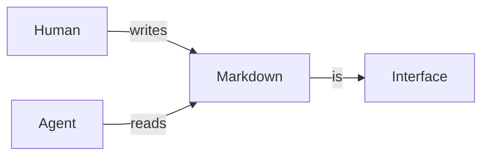

# Welcome to markturbo

This folder is a **sample workspace**. Everything here is an ordinary file —
open it in your editor, commit it to git, or hand it to an agent. Nothing was
converted on the way in and nothing will be on the way out.

The window has three controls at the top: this file's name on the left, and
**Review** and the **⚙** glyph on the right. Everything else lives in the ⚙
menu.

## Try this first

1. **Switch modes.** Open the **⚙** menu. Every document starts in **Split**:
   the source editor beside the rendered preview.
   - **Edit** is the source editor alone.
   - **Preview** is the rendered page alone, drawn natively — no browser.
   - **Web preview** and **Split · Web** render through an embedded browser
     instead, for compatibility. Scripts stay off unless you choose **Trust
     scripts** for that tab.
2. **Edit something.** Type in **Edit** or **Split**; the preview follows as
   you type. A dot after the file name means unsaved changes.
3. **Find another file.** Press `Ctrl+P` and type a few letters of its name.
   `Ctrl+Shift+F` searches inside the files. Each open file is a dot in the
   strip on the left; hover it to see the names.
4. **Open `docs/diagrams.md`** for live Mermaid, D2, PlantUML, and math — and
   for what a broken diagram looks like.
5. **Save** from the **⚙** menu (there is no `Ctrl+S`). The file is written
   back as plain Markdown in its original character encoding, byte-order mark,
   and line endings — a GBK or Shift-JIS document opened and saved untouched is
   byte-identical. If you type a character the encoding cannot hold, the save
   is refused rather than silently substituted. **Save As…** (`Ctrl+Shift+S`)
   writes UTF-8 and keeps the line endings and byte-order mark.

## See which instructions apply

Click the **file name** at the top (or choose **⚙ → Context**). Context lists
the instruction files that apply to this file, in the order they apply — later
overrides earlier — and the workspace's **Skills**. Tick **Include in review**
for a source you want sent along with the next Review; nothing is sent until
you do.

This workspace has two skills in `.claude/skills/`:

- `hello-diagrams` is a complete, valid Agent Skill: a directory with a
  `SKILL.md`, a `references/` guide, and a `scripts/` helper.
- `broken-example` is deliberately non-conformant. It is still listed — a broken
  skill you cannot see is worse than one you can fix. Open its `SKILL.md` to
  read what is wrong with it.

Press a skill's row in Context to open its `SKILL.md`.

## Ask for a review

Choose **Review** at the top, or press `Ctrl+Enter`. Nothing leaves the device
yet: first a **Send for review?** card shows where the request goes, what
**Leaves this device**, what **Stays here**, and the total. To send, press and
**hold** **Hold to send** (or hold `Ctrl+Enter`). Let go early and **Nothing was
sent.** A plain `Enter` or `Esc` cancels.

To review just part of a document, select it in the source editor and choose
**⚙ → Review selection**; the card's **Scope** then reads **Selection**. A
`SKILL.md` is always reviewed as its whole package, and the card lists every
package file on its own row.

The result shows the **Lens** markturbo inferred from the file name (`AGENTS.md`
or `CLAUDE.md` → Agent Instructions, `SKILL.md` → Agent Skill, a name with
`plan` or `spec` → Plan or Specification, anything else → Prompt), what the
model **Understood:**, and its questions. Answer or skip them, then **Prepare
revision**. Each proposed change can be **Accept**ed or **Reject**ed (`A` /
`R`); an accepted change is written into the editor at once, and `Ctrl+Z` takes
the last decision back with its text. **Done** (`Ctrl+Enter`) keeps what you
decided and counts any change you left undecided as not applied; **Copy** puts
the approved text on the clipboard. These keys work while the keyboard is
outside the editor, so typing in the document never decides a change. Nothing
is saved until you save.

Review needs a model. Set one up under **⚙ → Settings**; without one, Review
says **No model set up** instead of pretending.

## Diagrams and math render from source



Math renders natively too — no browser needed:

$$
\sum_{i=1}^{n} i = \frac{n(n+1)}{2}
$$

## Unicode works properly

中文段落，包含 `代码`、**粗体**、以及[链接](https://example.com)。

日本語も問題ありません。Emoji: 🎉 👩‍💻

## Try translation

Choose **⚙ → Translate**. A **Translate** dialog shows what will be sent; choose
**Send** to translate the whole document into the **Target language** from
Settings. It uses the same model as Review; without one, it reports that
translation is unavailable rather than inventing a result. The translation
replaces the editor text only if you have not edited the document meanwhile,
and nothing is saved — close the tab without saving to throw it away.

What it will *not* touch is the interesting part:

```rust
let value = String::new();   // code is never translated
```

Inline `code`, the URL in [this link](https://example.com/unchanged), the math
above, the diagram source, and the `#` heading markers all stay untouched. The
document engine splits the text into translatable and verbatim segments that
tile the range exactly, so the provider only ever sees prose — reassembly cannot
damage structure it never received.
